<div align="center">

# Rybbit for Android

**An unofficial native Android dashboard for [Rybbit](https://rybbit.com) analytics: Rybbit Cloud or your own self-hosted server.**

[](https://github.com/Tresillo2017/rybbit-android/actions/workflows/ci.yml)
[](https://github.com/Tresillo2017/rybbit-android/releases)
[](LICENSE)


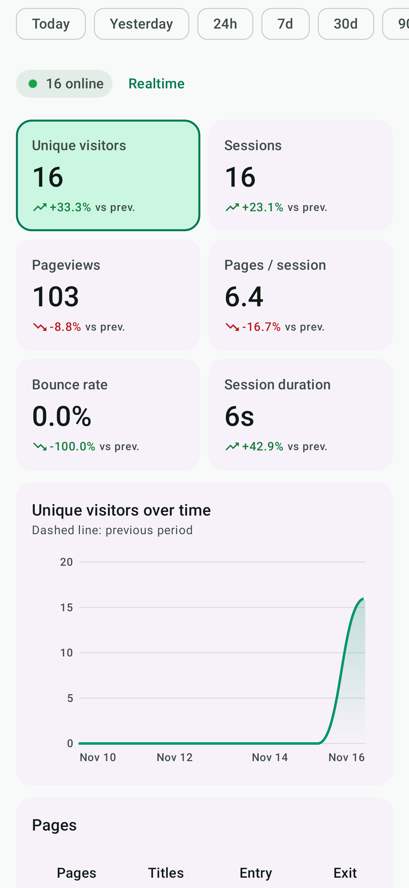
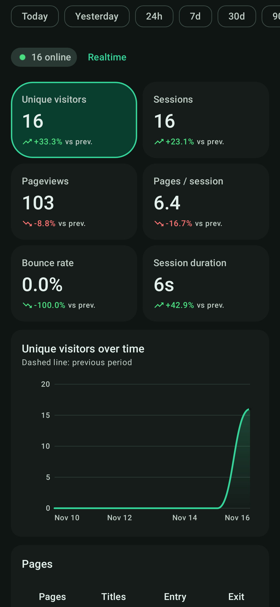
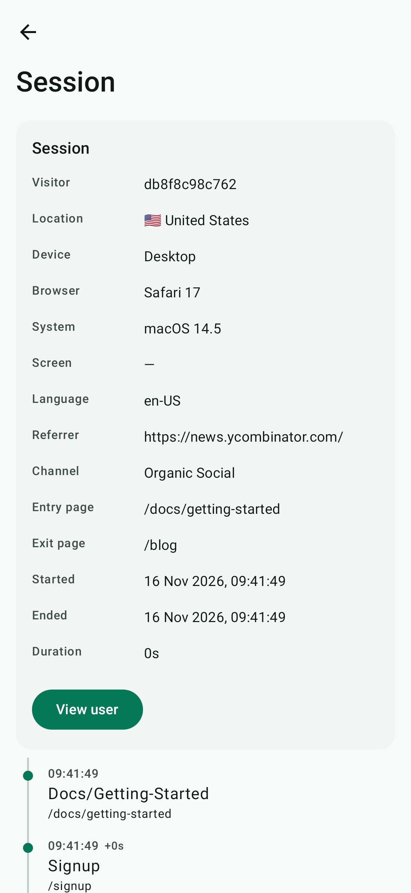

</div>

> [!NOTE]
> This is a community project and is **not affiliated with or endorsed by Rybbit**. It only reads data
> through Rybbit's public REST API.

## Features

- **Cloud and self-hosted.** Use the Rybbit Cloud preset or enter any server address. Sub-paths, custom
  ports and LAN `http://` addresses work (http shows a warning). You can add several servers and switch
  between them.
- **Two ways to sign in:**
  - Paste an API key (personal or organization).
  - Use email and password. The app then creates a personal API key named `Rybbit Android (<device>)` and
    stores only that key, so you aren't logged out when the 7-day web session expires.
- **Credentials stay protected.** They are encrypted with AES-GCM using a key in the Android Keystore, and
  never written to logs or backups.
- **Overview.** Live visitors, KPIs compared with the previous period, an interactive trend chart, and
  breakdowns by page, source, channel, UTM, country, device and language. Tap a breakdown row to filter
  the whole dashboard.
- **Sessions and users.** Infinite lists, session timelines with event properties, and user profiles.
- **Events and errors.** Custom events over time with property breakdowns, a live event stream, and
  grouped errors with stack traces.
- **Goals, funnels and retention.** Conversion rates, funnel drop-off, and a cohort heatmap.
- **Realtime and Web Vitals.** A live feed and visitor sparkline, plus LCP, CLS, INP, FCP and TTFB
  percentiles (Rybbit Cloud).
- **Shared filters.** One date range (presets or custom) and one set of filters apply to every tab of a
  site.
- **Adapts to your server.** Features a server doesn't offer (some are Cloud-only) are detected and hidden,
  without showing errors.
- **Material 3 design.** Dynamic color, dark mode, accessible charts with text summaries, and
  edge-to-edge layout.

## Screenshots

| Welcome | Add server | Sites | Sessions |
|:-:|:-:|:-:|:-:|
| 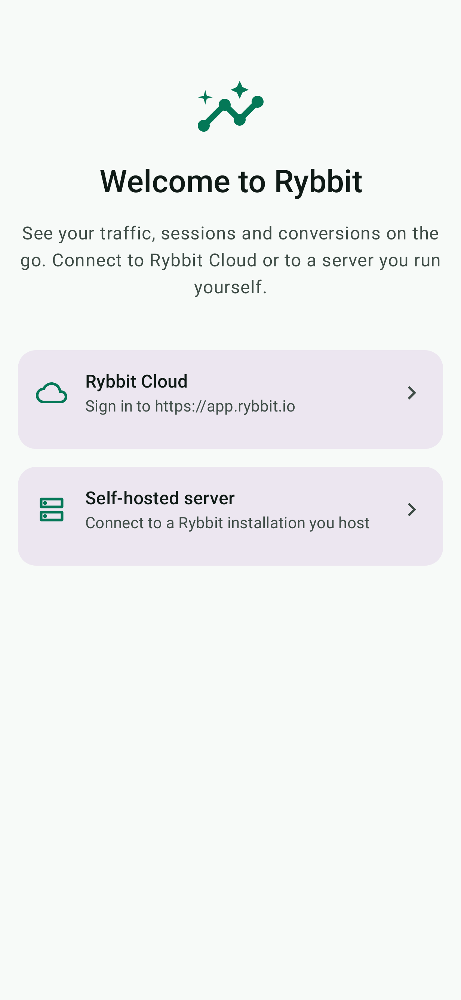 | 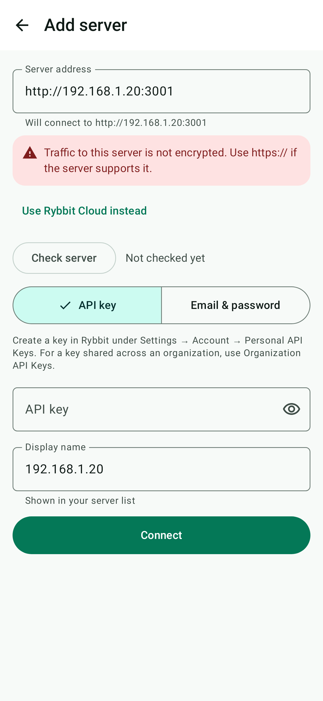 | 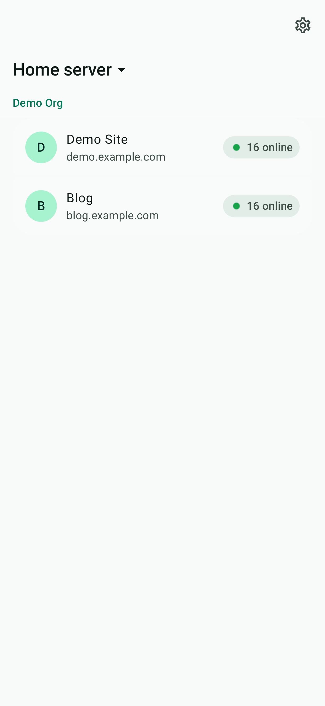 | 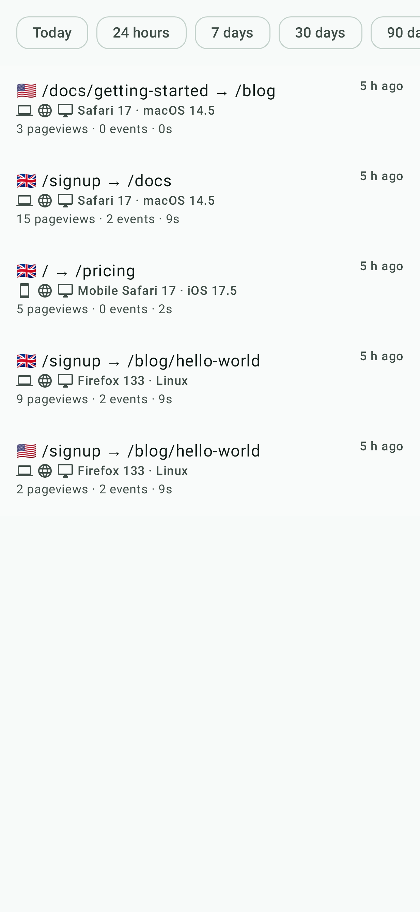 |
| **Events** | **Users** | **Goals** | **Funnel** |
| 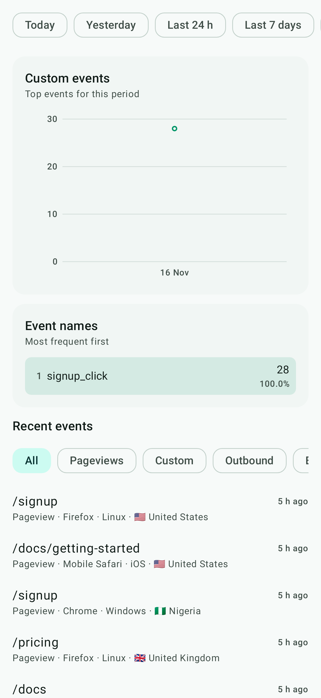 | 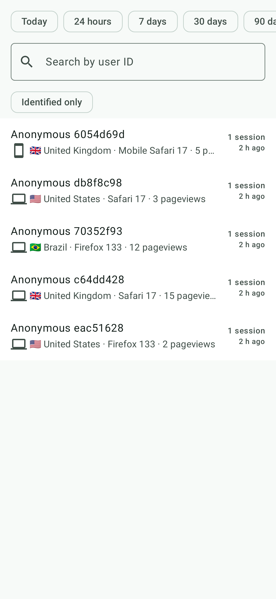 | 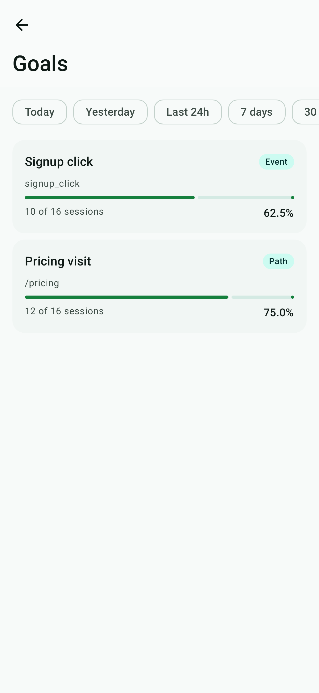 | 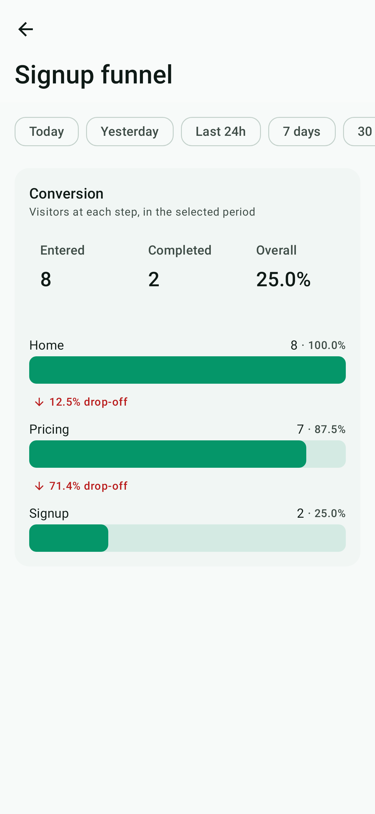 |
| **Retention** | **Errors** | **Error detail** | **Settings** |
| 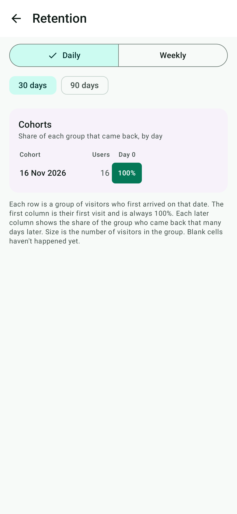 | 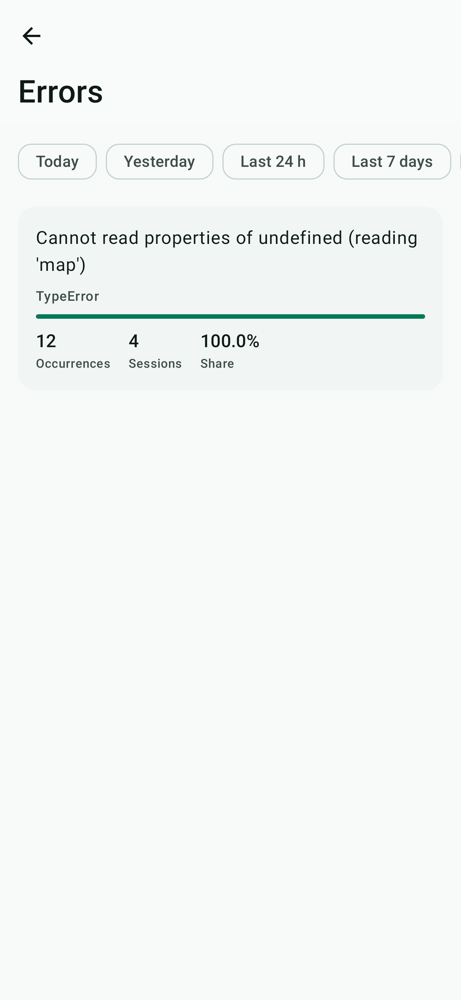 | 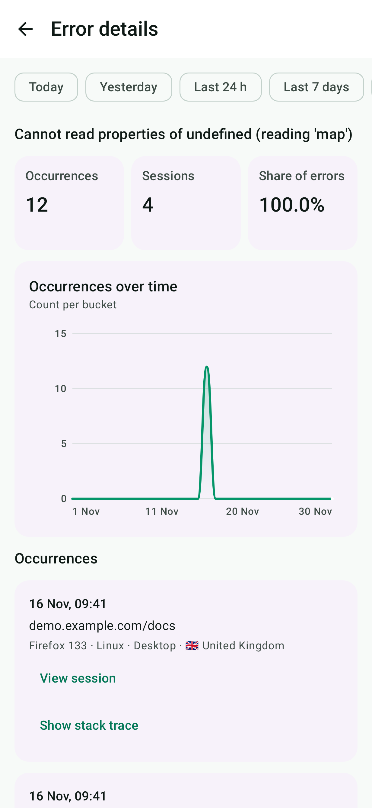 | 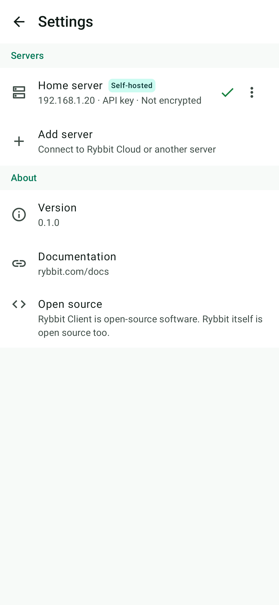 |

The screenshots are rendered from the real Compose screens with [Roborazzi](https://github.com/takahirom/roborazzi),
using real API responses captured from a self-hosted Rybbit server.

## Install

Download the APK from [Releases](https://github.com/Tresillo2017/rybbit-android/releases) and install it
(allow installs from unknown sources). Android 8.0 (API 26) or newer is required.

> [!WARNING]
> Pre-release builds are signed with a development key. Uninstall the app before switching to a build
> signed with a different key.

## Connecting your server

1. Open the app and choose **Rybbit Cloud** or **Self-hosted server**.
2. For a self-hosted server, enter its address, e.g. `analytics.example.com` or `http://192.168.1.20:3001`,
   and tap **Check server**.
3. Sign in using either method:
   - **API key**: create one in the Rybbit dashboard under **Settings → Account → Personal API Keys** or
     **Settings → Organization → Organization API Keys**.
   - **Email and password**: the app creates a personal API key for you.

Notes for self-hosters:

- **Redirects.** If your server redirects http→https or to a sub-path on the same host, the app uses the
  redirected address. Redirects to other hosts are refused, so credentials are never sent somewhere
  unexpected.
- **Self-signed certificates.** Install your CA certificate on the device. User-installed CAs are trusted
  for self-hosted servers but not for `app.rybbit.io`.
- **Cloud-only features.** Pages, Web Vitals, bots and Search Console aren't part of self-hosted Rybbit,
  so the app hides them on self-hosted servers.

## Building from source

Requirements: JDK 17+ (JDK 21 recommended) and the Android SDK with platform 37.

```bash
git clone https://github.com/Tresillo2017/rybbit-android.git
cd rybbit-android
./gradlew assembleDebug          # app/build/outputs/apk/debug/app-debug.apk
./gradlew testDebugUnitTest      # unit tests
./gradlew lintDebug              # Android lint
./gradlew recordRoborazziDebug   # regenerate docs/screenshots/*.png
```

### Testing against a live server

`LiveServerIntegrationTest` uses the real HTTP stack against a running Rybbit server. It is skipped
unless these variables are set:

```bash
RYBBIT_IT_URL=http://localhost:3001 RYBBIT_IT_EMAIL=you@example.com \
RYBBIT_IT_PASSWORD=... RYBBIT_IT_SITE=1 ./gradlew testDebugUnitTest
```

To run a local self-hosted stack:
1. Clone [`rybbit-io/rybbit`](https://github.com/rybbit-io/rybbit).
2. In `.env`, set `BASE_URL`, `BETTER_AUTH_SECRET` and the database passwords.
3. Run `docker compose up -d backend`.

From the Android emulator, the server is at `http://10.0.2.2:3001`.

## Architecture

The app uses Kotlin, Jetpack Compose and Material 3, Navigation Compose with type-safe routes, Ktor
(OkHttp engine) with kotlinx.serialization, DataStore, and the Android Keystore. Dependencies are wired by
hand in an `AppContainer`, with no Hilt or KSP.

```
app/src/main/java/app/rybbitclient/
├── core/
│   ├── network/   Ktor client, RybbitApi, typed ApiException, URL normalization
│   ├── auth/      server probe, API-key and email/password sign-in
│   ├── storage/   instances (DataStore) + Keystore-encrypted secrets
│   ├── data/      AnalyticsRepository, feature availability
│   ├── query/     date ranges, filters, shared site query state
│   └── ui/        theme, charts, KPI tiles, state views, formatters
├── feature/       onboarding, sites, overview, sessions, users, events, errors,
│                  goals, retention, realtime, performance, settings
└── navigation/    routes, NavHost, site scaffold with bottom navigation
```

[`docs/ARCHITECTURE.md`](docs/ARCHITECTURE.md) covers the API behaviour verified against a live server,
including several places where the server differs from the docs. [`docs/FEATURE_GUIDE.md`](docs/FEATURE_GUIDE.md)
explains how to add a screen. `docs/fixtures/` holds real API responses that the tests decode.

## Known limitations

- The app is read-only. Goals, funnels and site settings are managed in the web dashboard.
- Session replay, the SQL explorer and Search Console are not implemented.
- User search returns no results on some self-hosted builds, even though the app sends the documented
  parameters.
- When a key expires (401), you re-enter an API key in Settings; password re-login in place isn't
  supported yet.
- Removing a server from the app does not revoke the API key the app created. Revoke it in the web
  dashboard under **Settings → Account → API keys**.

## Contributing

Issues and pull requests are welcome. Please read [CONTRIBUTING.md](CONTRIBUTING.md) first. To report a
security issue, see [SECURITY.md](SECURITY.md).

## License

[MIT](LICENSE). Rybbit is a trademark of its respective owners, and Rybbit itself is licensed under
AGPL-3.0 in its own repository.
